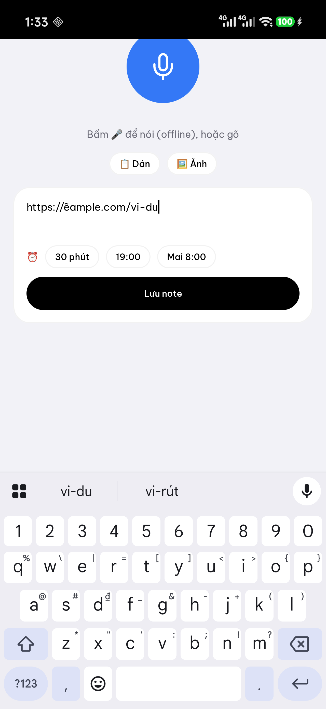

# Ghi chú nhanh: ma trận thao tác (nút "+" / nút nổi)

- Ngày: 20-10-2026 · Component: `capture/VoiceActivity.kt` · Phân loại: `05-designs`

| Thao tác | Trước | Nay | Lưu thành |
|---|---|---|---|
| Nói (whisper offline) | ● | ● | note |
| Gõ tay | ● | ● | note |
| Nhắc tự hiểu (luật + AI) | ● | ● | `remindAt` |
| Dán clipboard | ○ | ● nút "📋 Dán" | nối vào ô text |
| Đính ảnh (thư viện) | ○ | ● nút "🖼 Ảnh" + xem trước + ✕ | `imagePath`, hiện ở tab Note |
| Chọn giờ nhắc nhanh | ○ | ● chip ⏰ 30 phút · 19:00 · Mai 8:00 (chạm lại = bỏ) | `remindAt` (ưu tiên hơn luật/AI) |
| Tự nhận link | ○ | ● text là URL → type `link` | tab Link |
| Chọn thư mục / tag | ○ | — hoãn (AI gắn tag Phase 5) | — |
| Checklist, chụp ảnh camera | ○ | — YAGNI | — |

## Giới hạn
- Đã kiểm trên máy: chip ⏰ 30 phút → "Sẽ nhắc lúc 14:03" → lưu → hiện ở tab **Link** kèm ⏰ 14:03 (URL tự nhận) ✓; ảnh: 
- Chưa kiểm trên máy: nút Dán, Ảnh (picker hệ thống)
- Note mới: Note tab tự cuộn lên đầu (`LaunchedEffect` theo id mục đầu) — đã kiểm máy: note mới hiện thẻ đen ở đầu ✓
- Ảnh đính không OCR (khác `saveShot`); thêm khi cần tìm theo chữ trong ảnh
