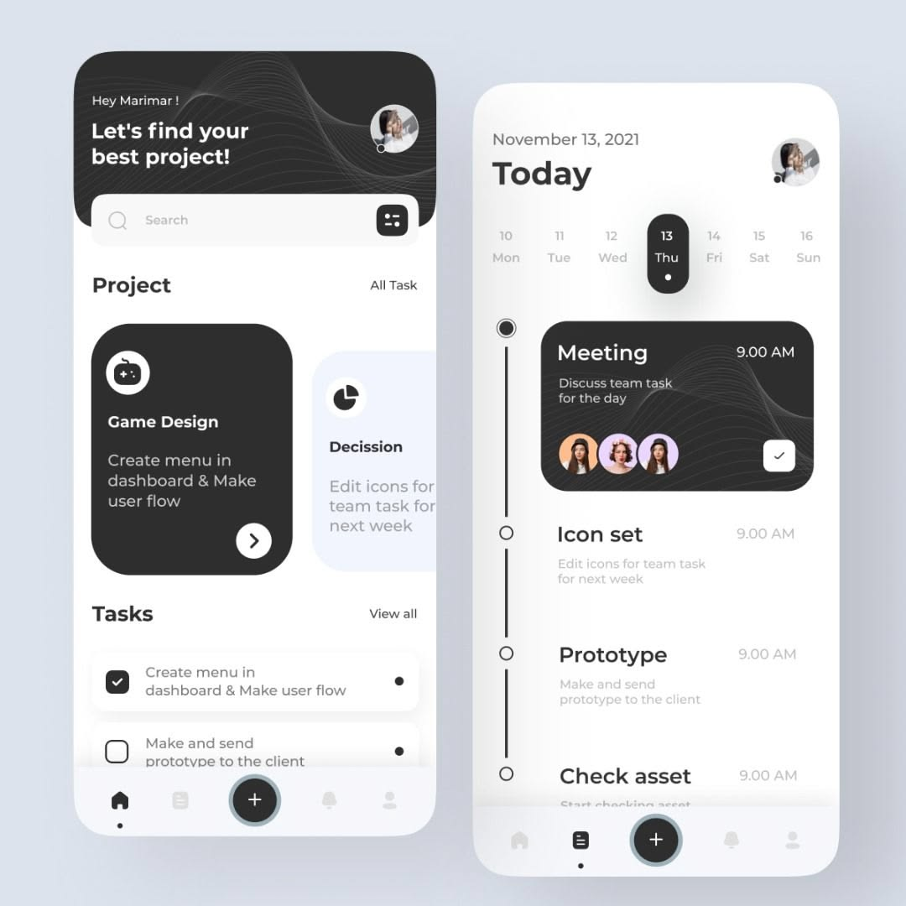
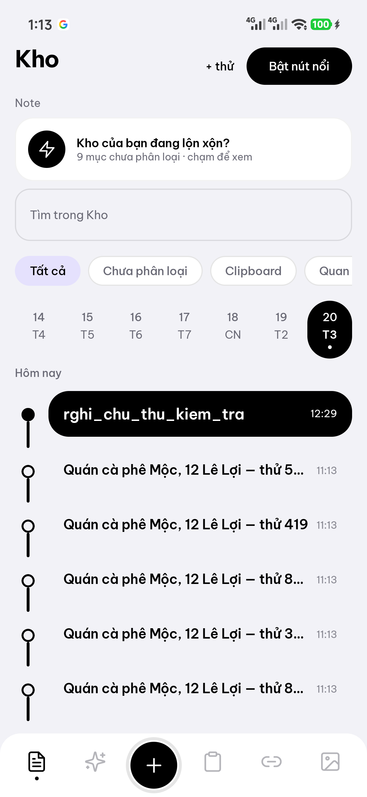
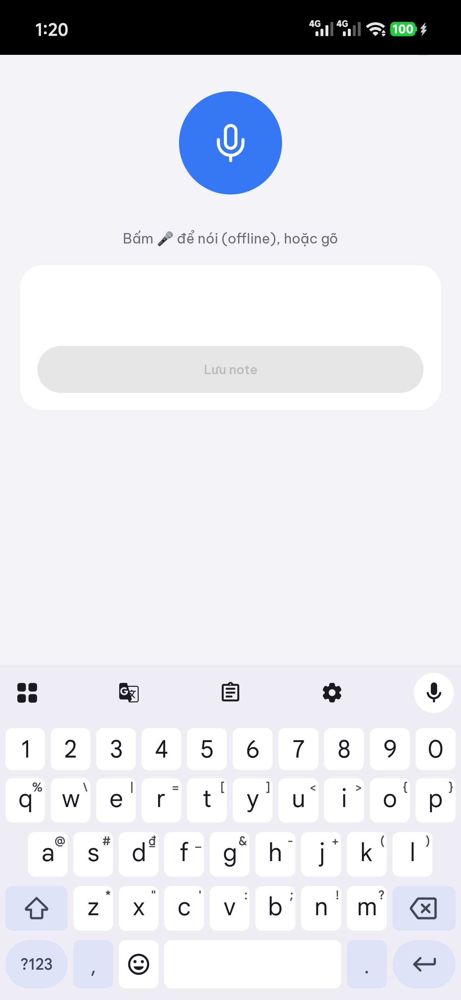

# Tham chiếu UI: timeline theo ngày + bottom nav (ảnh Dribbble)

- Ngày: 20-10-2026 · Phân loại: Jev `05-designs` 0.53 (review, Founder chọn)
- Ảnh gốc: 
- Ảnh máy thật sau khi áp: 
- Code: `ui/Timeline.kt` (BottomNav, DayStrip, TimelineRow), `ui/KhoScreen.kt`, icon `res/drawable/ic_note|ic_clipboard|ic_image|ic_plus.xml`

## Ghi chú ảnh (màn "Today")
- Header đen bo lớn + hoa văn sóng, ô tìm + nút lọc
- Thẻ Project: đen / xanh nhạt, bo 22
- Task: hàng có checkbox/chấm
- Day strip: ngày hôm nay = pill đen, chấm dưới = có việc
- Timeline: nút tròn + đường dọc dày; thẻ đầu đen ("Meeting")
- Bottom nav: 5 icon outline, "+" tròn đen giữa có vòng xám, chấm dưới icon đang chọn

## Node UI cắt nhỏ (vector)
| Node | Hình | Áp trong app |
|---|---|---|
| N1 pill ngày | bo 24, đen, 2 dòng số + thứ, chấm | `DayStrip` ✓ |
| N2 chấm có việc | tròn 4dp | `DayStrip` ✓ |
| N3 nút timeline | tròn 14dp, viền 2dp; mục đầu đặc | `TimelineRow` ✓ |
| N4 đường dọc | 3dp, bo tròn | `TimelineRow` ✓ |
| N5 thẻ đậm | bo 22, nền đen, chữ trắng, giờ phải | `TimelineRow` (mục đầu) ✓ |
| N6 thẻ thường | không nền, tiêu đề + phụ 2 dòng | `TimelineRow` ✓ |
| N7 nav icon | outline 24dp, chọn = đen, chưa = xám .5 | `BottomNav` ✓ |
| N8 chấm active | 4dp dưới icon | `BottomNav` ✓ |
| N9 nút "+" | tròn 60dp đen, vòng xám 3dp, icon trắng | `BottomNav` ✓ |
| N10 nền nav | surface bo trên 22 | `BottomNav` ✓ |
| N11 header đen + sóng | — | chưa (YAGNI) |
| N12 thẻ Project xanh nhạt | — | chưa |
| N13 task checkbox | — | chưa |

## Quyết định / giới hạn
- Tab trên bị bỏ, thay bằng nav dưới (5 trang: Note · Recap | + | Clipboard · Link · Ảnh)
- "+" = mở `VoiceActivity` (cùng màn Ghi chú nhanh với menu nút nổi): mic offline + gõ tay + Lưu note; ảnh: 
- Lọc theo ngày chỉ khi ô tìm trống; 30 ngày gần nhất
- Chưa kiểm: dark mode, lưu note thật từ "+"

## Restyle thẻ timeline + header (20-10-2026, v2 đơn sắc)

v1 pastel nhiều màu bị Founder chê xấu → bỏ. v2: đơn sắc + 1 accent.

| Phần | Quyết định |
|---|---|
| Thẻ | trắng (`surface`) + viền 1dp `outlineVariant`, bo 20dp (v3: bỏ thẻ đầu đen để thấy tint trạng thái) |
| Nút ray | vòng = màu trạng thái (đặc khi hoàn thành); đường dọc 2dp `outline` |
| Giờ | 12sp, màu phụ |
| Accent duy nhất | pill ⏰ nền `secondaryContainer` (tím nhạt), chữ đen |
| Header | tiêu đề = tên trang; Note có ô tìm riêng (toàn bộ ngày khi có từ khoá, ẩn day strip) |

Ảnh: `assets/timeline_cards_pastel_device_20-10-2026.png` (v1, đã xoá) · `assets/timeline_cards_mono_device_20-10-2026.png` (v2). Chưa kiểm dark.

## Thẻ Note v3: 7 trường + trạng thái + 4 buổi (20-10-2026)

| # | Trường | Hiển thị |
|---|---|---|
| 1 | Tiêu đề | 16sp semibold, 1 dòng; gạch ngang khi hoàn thành |
| 2 | Nội dung | 13sp, 2 dòng |
| 3 | Giờ tạo | góc phải trên, `HH:mm` |
| 4 | Giờ nhắc | pill ⏰ `secondaryContainer` |
| 5 | Nhắc lần N | pill; `Item.remindCount` +1 mỗi lần `RemindReceiver` nổ (goAsync + IO) |
| 6 | Trạng thái | pill tint + menu ▾; `Item.status` |
| 7 | Nhóm buổi | header buổi + khoảng giờ + số thẻ; mỗi buổi 1 timeline riêng |

| Buổi | Giờ | | Trạng thái | Tint |
|---|---|---|---|---|
| Sáng | 05–11 | | Chờ nhắc (open + có remindAt) | xanh dương |
| Trưa | 11–13 | | Quá hạn (open, remindAt < now) | đỏ |
| Chiều | 13–18 | | Hoàn thành | xanh lá |
| Tối | 18–05 | | Kết thúc | xám |
| | | | Dời lại (Dời 1 giờ → +1h, `scheduleRemind`) | cam |

- Thứ tự: Tối → Chiều → Trưa → Sáng (mới nhất trước); buổi rỗng ẩn; đang tìm = danh sách phẳng
- Menu: Hoàn thành · Kết thúc · Dời 1 giờ · Mở lại
- DB v3: migration 2→3 thêm `status TEXT DEFAULT 'open'`, `remindCount INTEGER DEFAULT 0`
- Kiểm máy ✓ (light): 2 buổi + đếm, menu 4 mục, Hoàn thành → tint lá + gạch ngang + nút đặc. Chưa kiểm: dark, "Nhắc lần N" sau khi báo thức nổ thật

Ảnh: `assets/timeline_status_parts_device_20-10-2026.png`

## Thẻ Note v4 "vé" (20-10-2026)

Ý tưởng: thẻ = vé có cuống; trạng thái đọc được từ xa không cần đọc chữ.

| Phần | Quyết định |
|---|---|
| Dải trạng thái | vạch dọc 4dp màu tint ở mép trái thẻ (thẻ không trạng thái = không vạch) |
| Nền | wash gradient ngang: tint alpha .10 → trong suốt (≈520px) |
| Đường xé | đường đứt 1dp (8/8) giữa nội dung ↔ hàng chip (chỉ khi có chip) |
| Giờ nhắc | pill ⏰ `HH:mm · còn 5g` / `· trễ 2g` (p/g/n); chỉ khi status = open |
| Giữ nguyên | 7 trường, 4 buổi, menu trạng thái, nút ray theo tint |

Code: `ui/Timeline.kt` (`TimelineRow`, `countdown`). Ảnh: `assets/timeline_ticket_card_device_20-10-2026.png`. Kiểm máy ✓ (Hoàn thành: vạch lá + wash + đường xé); chưa kiểm: chip "còn/trễ" trên máy, dark.

## Thanh lọc trạng thái Note (20-10-2026)

Nguồn: ảnh Founder (segmented To do · Completed · Pending). Khay trắng bo tròn, mục chọn = pill đen + icon outline + nhãn + số lượng.

| Tab | Điều kiện (`statGroup`) | Icon |
|---|---|---|
| Cần làm | status open, không có giờ nhắc | `ic_todo` |
| Hoàn thành | done ∪ ended | `ic_check` |
| Chờ nhắc | snoozed hoặc có `remindAt` (chờ/quá hạn/dời) | `ic_clock` |

- Mặc định không chọn = tất cả; chạm tab đang chọn = bỏ lọc; mục chọn rộng hơn (weight 1.25)
- Số = đếm trong tập đang xem (ngày đang chọn, hoặc kết quả tìm/lọc); lọc trạng thái KHÔNG bỏ giới hạn ngày
- Code: `StatusTabs`/`statGroup` (`ui/Timeline.kt`), `statF` + `shown0→shown` (`KhoScreen.kt`); icon `res/drawable/ic_{todo,check,clock}.xml`
- Kiểm máy ✓ light: chọn Hoàn thành → còn 1 thẻ (Chiều 1). Chưa kiểm dark, tab Cần làm/Chờ nhắc

Ảnh: `assets/note_status_tabs_device_20-10-2026.png`

## Bộ lọc Note dạng icon + dropdown (D15)
- Icon filter (`FilterList`) nằm **bên trái, ngang hàng StatusTabs**; badge = số nhóm lọc đang bật
- **Modal bottom sheet** (M3 `ModalBottomSheet`; dropdown lồng dropdown lỗi): ô tìm · 3 combobox M3 `ExposedDropdownMenuBox` **Loại · Tag · Buổi** (menu giữ mở + checkbox = chọn nhiều, vì M3 không có multi-select sẵn; rỗng = "Tất cả") · "Nhóm theo" (chọn 1) · Xoá lọc — không dùng chip
- Style dropdown: ô tìm + combobox = `TextField` filled tonal (`surfaceVariant` 50%, bo 16, không viền, nhãn nổi trong ô, `fieldColors()`); menu bo 18 nền `surface` đổ bóng 8dp; mục chọn = nền `secondaryContainer` + chữ SemiBold, Checkbox/Radio màu `primary`
- DayStrip (tuần) luôn hiện; đang lọc/tìm ⇒ kết quả trong **tuần** đang xem ("N kết quả trong tuần"), không còn trong 1 ngày
- Logic: OR trong nhóm, AND giữa nhóm; code `KhoScreen.kt` (`FilterCombo`, `kindF`/`tagF`/`partF` = `Set`), `StatusTabs(modifier)`
- Ảnh: `note_filter_dropdown_device_20-10-2026.png`, `note_filter_left_of_tabs_device_20-10-2026.png`

## Thẻ Note kiểu ghim giấy (D16)
- Mẫu: ảnh "How to Build Trust" (skale) — khung trắng bo 24 nghiêng ±1° xen kẽ, đinh ghim tròn (radial + glow) trên giữa, panel pastel bo 18 bên trong
- Màu panel/đinh = màu trạng thái (Hoàn thành xanh lá, Quá hạn đỏ, Chờ nhắc xanh dương…); chưa có trạng thái → xoay cam / xanh / tím theo số thứ tự
- Phân vùng: **khung trắng** = số `01` (Light, màu accent) + giờ tạo (hàng đầu) và chip (loại, tag, giờ nhắc, Nhắc lần N, trạng thái chạm để đổi) ở cuối; **panel pastel** chỉ chứa tiêu đề đậm 17 (≤2 dòng) + mô tả ≤3 dòng
- Chạm: lò xo (damping .55) — thẻ co 3%, xoay thẳng về 0°, đinh co 20% + lún 3dp, ripple M3; thả = bật lại
- Bỏ ray timeline (dấu chấm + vạch dọc); `TimelineRow(item, no, onClick, onStatus)`
- Ảnh máy: `note_card_pinned_device_20-10-2026.png`

## Buổi hiện tại (20-10-2026)
- Nhóm buổi (Sáng/Trưa/Chiều/Tối) xếp buổi trùng giờ hiện tại lên đầu; các buổi còn lại giữ thứ tự cũ.
- Báo sáng: chip xanh "Bây giờ" + chấm nhấp nháy (`LiveDot`) trên tiêu đề buổi và trên từng thẻ có `createdAt` thuộc buổi hiện tại **của hôm nay** (`isLive`). Ngày khác → không sáng.
- Chỉ tính lúc vẽ; qua ranh giới buổi (05/11/13/18h) cần vẽ lại (mở lại tab) mới đổi.
- Ảnh máy: [live_part_device](assets/live_part_device_20-10-2026.png)
